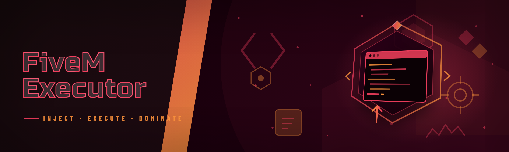

  
  
  

  

  
  
  

---

FiveM script executor: Lua injector, DLL bypass, ESP, aimbot, spoofer, and resource dumper for CFX servers

## Overview

FiveM script executor: Lua injector, DLL bypass, ESP, aimbot, spoofer, and resource dumper for CFX servers

  

## License

[MIT License](LICENSE)

  

